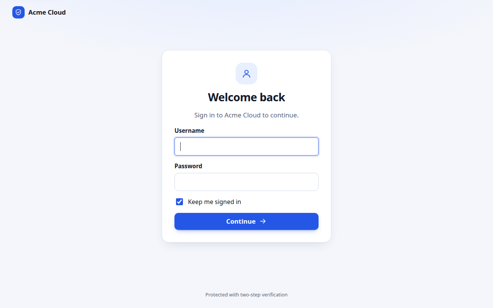
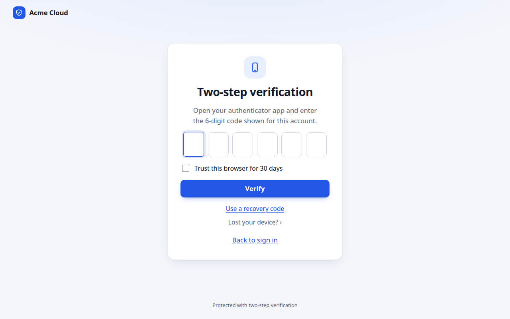
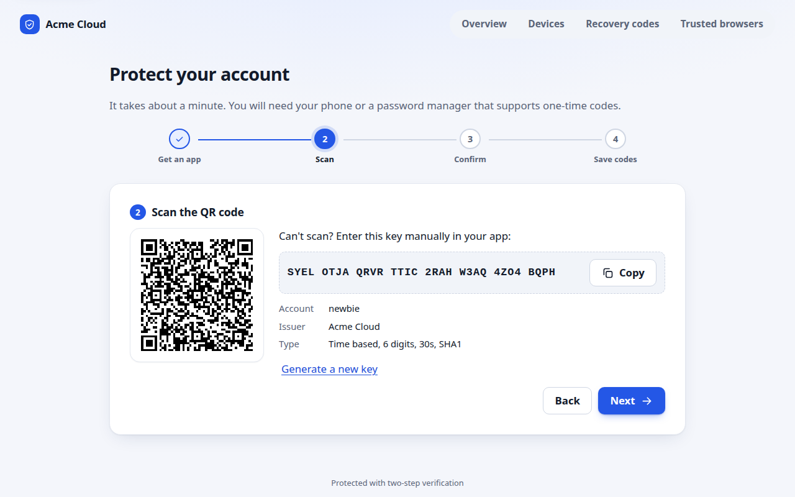
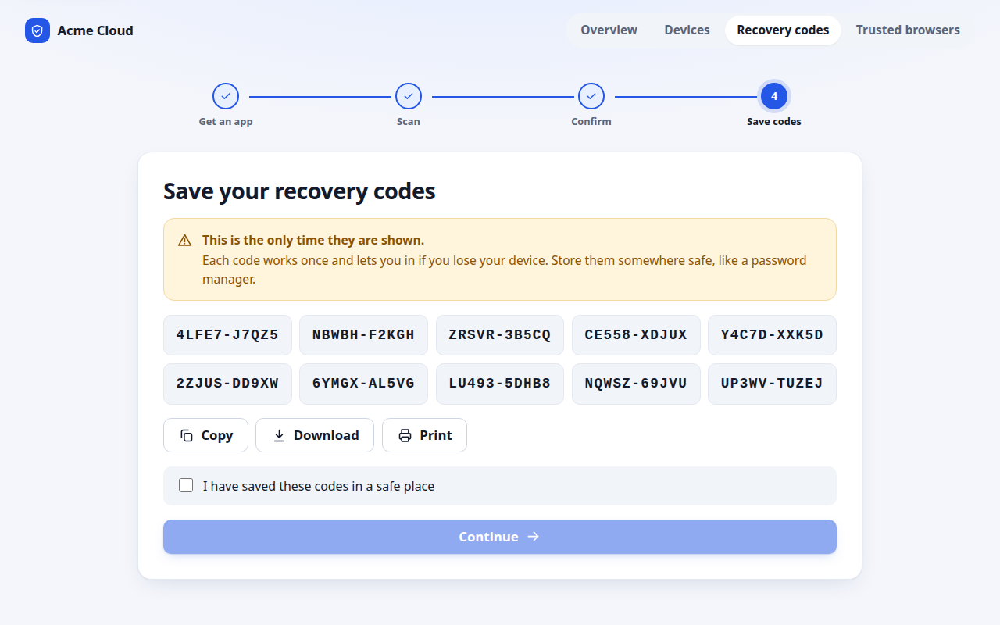
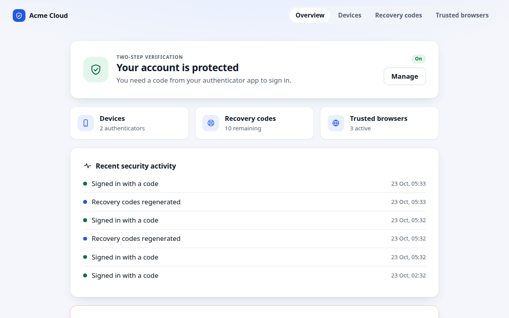
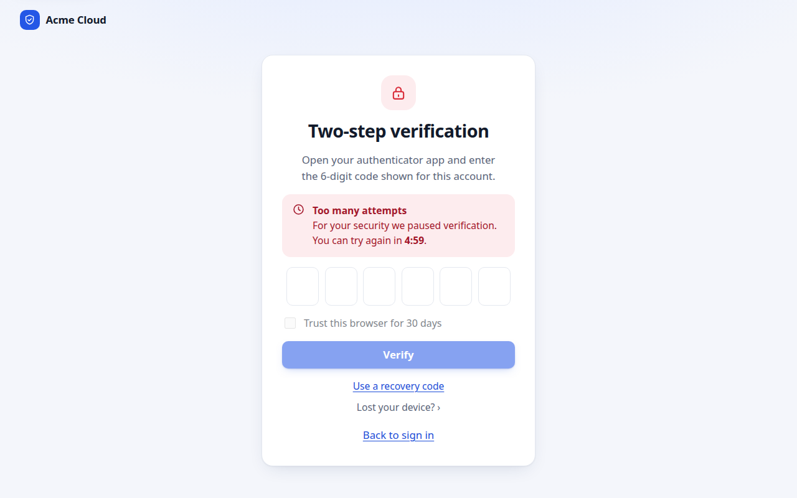
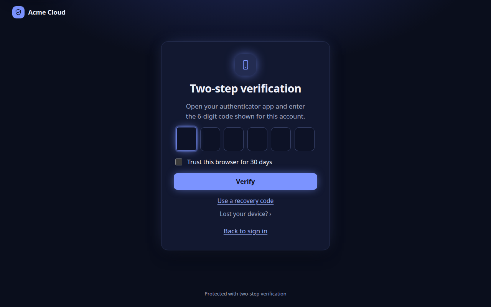
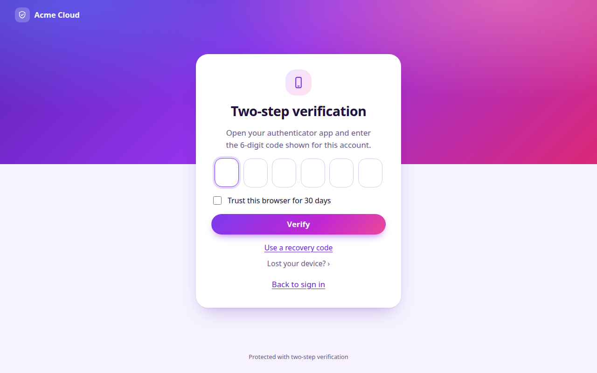
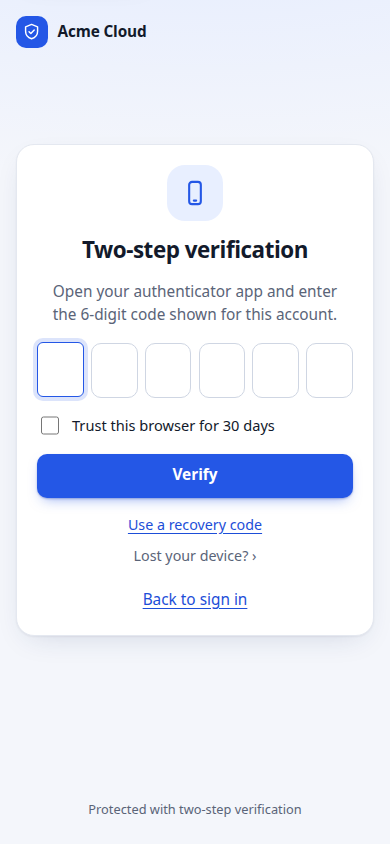

# dj-totp-2fa

Two-factor authentication for Django using time-based one-time passwords (TOTP, [RFC 6238](https://datatracker.ietf.org/doc/html/rfc6238)).
It plugs into `django.contrib.auth`, protects the admin, and works with Google Authenticator and any other standard authenticator app.

> Google Authenticator is a trademark of Google LLC. This project is independent and not affiliated with or endorsed by Google.
> It implements the open TOTP standard, so it works with Microsoft Authenticator, Authy, 1Password, Aegis, Bitwarden and similar apps.

**Status:** early release (0.1.0). The code and its 340+ tests pass, but the long-form docs are still being written. See `SECURITY.md` for the threat model summary.

## Features

- **Standard TOTP.** HMAC-SHA1 by default (works with every app), SHA256/SHA512 optional. Checked against the RFC 4226 and RFC 6238 test vectors.
- **Unpredictable secrets.** Secrets and recovery codes come from Python's `secrets` module. A secret is 160 bits by default, a recovery code about 50 bits.
- **Replay protection.** A code that was accepted once cannot be used again, even by two simultaneous requests.
- **Rate limiting and lockouts.** Limits per login attempt, per user, per IP and globally, with escalating lockouts that are also stored in the database so a cache flush does not reset them.
- **Abuse protection.** No user enumeration, equal work for unknown and locked users, a honeypot field and minimum submit time, trusted-proxy aware client IPs, IP allow and deny lists, lockout emails, and an audit log.
- **Native Django integration.** A drop-in login view, middleware that enforces 2FA on any login route (admin, allauth, custom), decorators and mixins, step-up re-verification for sensitive pages, and a JSON API for single-page apps.
- **Recovery and trust.** One-time recovery codes (stored only as salted hashes), multiple devices per user, and an optional "trust this browser" cookie.
- **Policy.** Require 2FA for everyone, staff, superusers, groups or a custom rule, with an enrolment grace period.
- **Modern, responsive UI.** Six-box code entry with paste and autofill, a client-side QR code (vendored, no CDN), three themes (`clean`, `midnight`, `aurora`) plus `auto`, and no inline scripts or styles so it works under a strict Content Security Policy.
- **Dependencies.** Django only. `cryptography` is optional (`pip install dj-totp-2fa[crypto]`) and enables encryption of secrets at rest.

## Install

```bash
pip install dj-totp-2fa            # or: pip install dj-totp-2fa[crypto]
```

```python
# settings.py
INSTALLED_APPS += ["dj_totp_2fa"]

MIDDLEWARE += ["dj_totp_2fa.middleware.TwoFactorMiddleware"]   # after AuthenticationMiddleware and MessageMiddleware

TEMPLATES[0]["OPTIONS"]["context_processors"] += ["dj_totp_2fa.context_processors.two_factor"]

LOGIN_URL = "dj_totp_2fa:login"

TOTP_ISSUER = "My Site"          # shown in the authenticator app
TOTP_REQUIRED = "staff"          # False, True, "staff", "superuser", ["group"], or a function(user, request)
```

```python
# urls.py
urlpatterns += [path("account/2fa/", include("dj_totp_2fa.urls"))]
```

```bash
python manage.py migrate
```

Users enrol at `/account/2fa/`. Staff who must use 2FA are sent there automatically, and the Django admin login now asks for a code.

## Protect your own views

```python
from dj_totp_2fa.decorators import two_factor_required, otp_fresh

@two_factor_required            # session must have passed 2FA
def dashboard(request): ...

@otp_fresh(max_age=300)         # ask for a new code if the last one is older than 5 minutes
def change_payout_account(request): ...
```

Class-based views have `TwoFactorRequiredMixin` and `OTPFreshMixin`. Requests that expect JSON get a `401` with the code `two_factor_required` instead of a redirect.

## Settings

Set any option as `TOTP_<NAME>` or inside a `DJ_TOTP_2FA = {...}` dict. Unknown names are reported with a suggestion, and `python manage.py totp_settings --markdown` prints the full reference. The most useful ones:

| Setting | Default | Meaning |
|---|---|---|
| `REQUIRED` | `False` | Who must use 2FA |
| `ENROLMENT_GRACE_DAYS` | `0` | Days required users may sign in without 2FA before enrolment is forced |
| `WINDOW` | `1` | Steps either side of now that are accepted (0 to 2) |
| `PENDING_MAX_ATTEMPTS` | `5` | Wrong codes allowed per login before the user must re-enter the password |
| `USER_FAILURE_LIMIT` / `USER_FAILURE_WINDOW` | `10` / `900` | Failures per user before a lockout |
| `LOCKOUT_STEPS` | `[60, 300, 900, 3600, 86400]` | Escalating lockout durations (seconds) |
| `IP_FAILURE_LIMIT` | `20` | Failures per IP before an IP lockout |
| `TRUSTED_PROXIES`, `CLIENT_IP_HEADER` | `[]`, `X-Forwarded-For` | Honour forwarded IPs only from these proxies |
| `REMEMBER_BROWSER` | `30` | Days a trusted browser skips the code step (0 disables) |
| `SECRET_ENCRYPTION`, `ENCRYPTION_KEYS` | `auto`, `[]` | Fernet encryption of secrets at rest |
| `PROTECT_ADMIN` | `True` | Require 2FA for the Django admin |
| `THEME` | `clean` | `clean`, `midnight`, `aurora` or `auto` |
| `BASE_TEMPLATE`, `BRAND_NAME`, `LOGO_URL`, `EXTRA_CSS` | | Make the pages match your site |
| `NOTIFY` | all on | Which security emails to send |
| `ON_VERIFIED`, `ON_FAILED`, `ON_LOCKOUT`, `RULES`, `CODE_VALIDATOR` | | Your own hooks |
| `STORE_IP`, `ANONYMIZE_IP`, `EVENT_RETENTION_DAYS` | `True`, `False`, `365` | Privacy and retention of the audit log |

Use a shared cache (Redis or Memcached) when you run more than one worker, so counters are shared. Lockouts are also saved in the database as a safety net.

## Commands

| Command | Purpose |
|---|---|
| `totp_doctor` | Check configuration, middleware, cache, templates and migrations (`--strict`, `--json`) |
| `totp_simulate` | Run a full password to code to access flow in-process and print PASS or FAIL |
| `totp_status [user]` | Show 2FA status |
| `totp_enable_test <user>` | Development only: create a confirmed device and print its URI |
| `totp_code <user>` | Development only: print the current valid code |
| `totp_disable <user>` | Disable 2FA for a user (audited) |
| `totp_reset_lockout` | Clear a lockout for a user or IP |
| `totp_purge_events` | Delete audit events past the retention period |
| `totp_rotate_keys` | Re-encrypt secrets with the newest key |
| `totp_settings` | Print the effective settings or a Markdown reference |

## Screens

| Sign in | Enter code | Set up |
|---|---|---|
|  |  |  |

| Recovery codes | Overview | Locked out |
|---|---|---|
|  |  |  |

Dark and gradient themes, and mobile layouts, are in `docs/screenshots/midnight`, `docs/screenshots/aurora` and the `*-mobile.png` files.

| Midnight | Aurora | Mobile |
|---|---|---|
|  |  |  |

## How brute force is limited

A six digit code has one million possibilities. With the defaults an attacker gets 5 wrong tries per login, 10 per user per 15 minutes before an escalating lockout (1 minute up to 24 hours), and 20 per IP, plus a global circuit breaker. A guessed code is also only valid for about 90 seconds (the 30 second step with a window of one either side), and can be used once.

## Testing

```bash
python runtests.py        # prints "All tests passed." on success
```

## License

MIT, see [LICENSE](LICENSE). The bundled QR generator is `qrcode-generator` by Kazuhiko Arase (MIT), licence text in `dj_totp_2fa/static/dj_totp_2fa/js/vendor/`.
